## 1. Introduction

I am a web developer: I work with **React, Next.js and Node**, not with mobile apps. Of everything this project uses, I
only knew **Clean Architecture** well: separating data, business logic and presentation, and making the dependencies
point inwards. **Flutter, Dart and BLoC were new to me**, and of Firebase I had only used Firestore, in a personal project for a
course.

My first feeling was enthusiasm. The night the email with the assignment arrived, I watched all the videos linked in the
documentation, so that the next day I could start following the steps of the README while reading the rest of the
documents along the way. I also looked at what the people who work at Symmetry share publicly about their stack and how
they work, to understand the context of the test, and part of it matched the stack of the Clean Architecture tutorial
the README recommends. Only then did I start on the code.

I based the work entirely on the README, every document it links, and that tutorial. What stood out when I read the
documentation was how precise it is: [ARCHITECTURE_VIOLATIONS.md](ARCHITECTURE_VIOLATIONS.md) lists the rules a
reviewer rejects a pull request for, and [CODING_GUIDELINES.md](CODING_GUIDELINES.md) asks for small functions,
meaningful names and tests. I decided early that the documentation would be the acceptance criteria of every change,
not a reading list, and that whatever I could not do as written I would say in this report.

Honestly, it was complex. Coming from React, Next.js and Node, following the architecture was not hard, because the
layers and the dependency rule were familiar, but understanding the Flutter code completely (widgets, generated code,
how BLoC connects state to the UI) took real effort.

I followed the order of the README: the backend (schema, collection, rules), then the frontend (Firebase, domain with
mock data, presentation, data layer), then this report, with one commit per step.

## 2. Learning Journey

### Resources
- **The [Flutter Clean Architecture Tutorial](https://www.youtube.com/watch?v=7V_P6dovixg)** the frontend README
  recommends. It is really good: it builds this very project, with a case very close to this task, and explains each
  layer clearly. It made me much calmer about the test, and I kept going back to it later, when documenting my own
  code.
- **The README and every document it links**: the architecture, the violations, the coding guidelines and the
  contribution guidelines, read before writing code and read again before each step.
- **The [Kodeco BLoC tutorial](https://www.kodeco.com/31973428-getting-started-with-the-bloc-pattern)** linked by the
  README, and the official documentation of Flutter and Firebase.
- **What Symmetry's team share publicly** about their stack and their way of working, to see the context of the tools
  the test asks for.

### Flutter and Dart
Flutter and Dart were complex for me. To understand them I kept bringing them back to what I use every day in React:
a widget rebuilt from state is close to a component rendering again from its props and state, a `StatelessWidget` is like
a function component, and the widget tree is like the component tree. That comparison got me started, but there was a
lot that React does not prepare you for: layout with constraints (`Expanded`, `Flexible`, overflows), Dart's null safety
and its code generation (`build_runner`), and reading a whole codebase in a language I had never used. The videos and the
documentation are what made it work: the Clean Architecture tutorial walks through this same project, so I could follow
its code with someone explaining it. Layout is where I learned the most, mostly from widget tests that caught real
overflows (see [challenges](#3-challenges-faced)).

### BLoC and Cubit
The same happened with state management. I understood BLoC by comparing it with React: a Cubit is close to a store or
a `useReducer` that lives outside the component, its states are like the loading, success and error states of a
request, and `BlocBuilder` is like a component subscribed to that store. With the
[Kodeco tutorial](https://www.kodeco.com/31973428-getting-started-with-the-bloc-pattern) linked by the README and the
Clean Architecture video it became clear. I used Cubits for every new screen, with the states named as in that tutorial
(`InProgress`, `Success`, `Failure`). The rule that blocs are the only place that uses use cases (ARCHITECTURE_VIOLATIONS
3.2.2) made the screens simple: they only read state and send events.

### Firebase
I had used Firebase Firestore before, in a personal project for a course, so the database itself was not new. What was
new was everything around it: Cloud Storage, Firebase Authentication and, above all, the **security rules language**. I
learned that the rules are the real backend of this app: they are what enforces the schema, so I wrote them test first
with [@firebase/rules-unit-testing](https://firebase.google.com/docs/rules/unit-tests) and the
[Local Emulator Suite](https://firebase.google.com/docs/emulator-suite). The emulators became the center of the
development setup (see the Blaze plan in [challenges](#3-challenges-faced)).

### Working with an AI coding assistant
I built this project with **Claude Code** (Anthropic's coding agent) as my pair: it wrote most of the code, the tests
and the documentation, while I directed the work. I want to be transparent about how, because the result should be
judged knowing it. Every feature followed the same loop:

1. **Read the documentation.** Before any change we went through the README and the documents it links. I set one rule
   from the first day: every decision and every line of code must respect the project's documentation, and any
   conflict (versions, tools, the Blaze plan) is decided with me, never ignored.
2. **Design.** Every visual change was first designed in Claude Design as a clickable prototype; I approved it, or asked
   for changes (like the comment box as a glass pill instead of a bar), before anything was implemented.
3. **Plan the execution.** For each step of the README and each feature, a written plan: the files of each layer, the
   rules each part satisfies, the tests, and the order of the commits. I made the product and architecture decisions
   in that plan: the hybrid Firebase setup instead of paying for Blaze; mandatory login and the author taken from the
   account; comments counted at read time; saved articles stored in the account; toasts with a
   library, at the bottom; fixing the original code instead of documenting exceptions; and the tests that check the code
   against the documentation.
4. **Review.** Before each change, an explanation of what it does and which rule each part satisfies; after it, the
   tests and the app itself on the Android emulator, with a release build.
5. **Execute.** Implement, verify, and commit with a message I approved. Nothing was pushed until the end.

What I learned from working this way: to specify precisely, to ask for the reasons behind a change, to treat tests and
the documentation as the definition of "done", and to read code to verify it rather than to write it line by line. It
also let me learn an unfamiliar stack much faster, because every change came with an explanation tied to a rule.

## 3. Challenges Faced

### Cloud Storage now requires the Blaze plan
The README asks for article thumbnails in Cloud Storage, but since February 3, 2026 Firebase only creates new buckets for
projects on the paid Blaze plan, so a free (Spark) project cannot have Cloud Storage at all. I chose a **hybrid
setup**: the real project (`symmetry-news-1d028`, Spark) gets
the Firestore rules and indexes, and the app uses the **Firebase Local Emulator Suite by default** (Firestore, Storage
and Auth). `storage.rules` is complete and tested against the Storage emulator. With Blaze, only configuration changes
(`--dart-define=USE_FIREBASE_EMULATORS=false` and `firebase deploy`), not code. This is documented in
[backend/README.md](../backend/README.md).

### Abandoned dependencies of the original project
The starter used **Floor** (local database) and **Retrofit**, both generated with `build_runner`. `floor_generator` (last
release in May 2024) pins `analyzer` 6.4; Retrofit's generator either does not compile on Dart 3.13 or needs an analyzer
that depends on `_macros`, removed from the SDK. After comparing replacing Floor, pinning an old Flutter or replacing
Retrofit, I replaced Retrofit with a small Dio service written by hand (one endpoint). The same conflict prevents
installing `bloc_test`, so the Cubit tests use `flutter_test` stream matchers and `mocktail`. I also found that the
original Retrofit generated file had been edited by hand.

### Security rules that look right but are not
The rules tests found things a manual check would have missed:
- in Cloud Storage, uploading over an existing file is a `create`, not an `update`, so "no overwrites" needs
  `resource == null`;
- an audit of the rules found a real hole: `thumbnailURL` accepted a URL in **any** bucket, where `storage.rules` do not
  apply; it is now pinned to this project's bucket and to the article's own file;
- an empty `firestore.indexes.json` (0 bytes in the starter) made `firebase deploy` fail with a parse error that the
  emulator never shows;
- `clearStorage()` of the testing library does not delete sub-folders, so the tests clean them recursively.

### The author's name after registration
The rules require `author == request.auth.token.name`, but a freshly created account's token has no name until it is
refreshed, so the first article of a new journalist was rejected. Registration now updates the display name and
forces a token refresh (`getIdToken(true)`); a data-source test covers it.

### Widget tests caught real bugs
Widget tests found an overflow in "Don't have an account? Sign up" (a `Row` that breaks with large text: now a `Wrap`),
a date that overflowed narrow article cards, and a `pumpAndSettle` that never settled because a loading shimmer
animated forever for an article without an image (the detail now skips the download, like the card).

### Making the original code respect the documentation
Some rules were broken by the starter code itself, and I fixed them with the Boy Scout rule instead of listing them as
exceptions: the Daily News feature used `usecases/` and `pages/` instead of `use_cases/` and `screens/`; its model
imported Floor and had no `fromRawData`/`toEntity()`; its repository imported Dio; the entities used the `equatable`
package although the domain must be pure Dart. To make sure they stay fixed, the tests in `test/architecture` now
check those rules on every run (see [section 7](#7-extra-sections)).

### Documentation that was out of date
Following the READMEs to the letter showed errors, which I fixed in the documentation itself:
- **frontend/README.md**: the steps were out of order, it used the deprecated `flutter pub run` (now `dart run`), it
  described `flutter_launcher_icons`, which the project did not use, and the links of its index were broken. It also
  asked for Java 17, but the current Firebase emulators require Java 21, and it did not mention Node.js and the
  Firebase CLI. It now explains how to run the app against the emulators with demo accounts, without a Firebase account,
  and how to run the tests.
- **backend/README.md**: it now explains the Blaze limitation, Firebase Authentication, the seed script and the tests.
- **`firestore.indexes.json`** was an empty file (see the rules above), and the original Retrofit generated file had been
  edited by hand.

## 4. Reflection and Future Directions

### Reflection
It was a very good experience, even though it happened in exactly three days in which I also had two exams. That
forced me to organize myself well, so that each part got the time it deserved: reading and planning first, then building
step by step. I finished it excited to keep going with this stack and to keep learning.

Coming from React, Next.js and Node, I also learned that knowing an architecture is not the same as knowing a codebase:
the layers were familiar from the first day, but reading Flutter code fluently took effort, and asking for the reason
behind every change was what made it click. Professionally, I learned to make decisions under real constraints (a paid
plan I chose not to use, abandoned libraries) and to document them honestly instead of hiding them, which is what
Symmetry's "Truth is King" asks for.

### Future directions
- **Drafts**: save an article halfway and come back to finish it later, from any device, before publishing it.
- **Follow journalists**: follow the writers you like and see their new articles first.
- **Comments**: edit and delete, and live updates.
- **Account**: password reset and email verification.
- **Articles**: Markdown for subtitles (an idea from the Figma notes), editing and deleting, pagination of the feed.
- **Integration tests on a device** with `integration_test`, and a CI workflow that runs the Flutter, rules and schema
  tests on every pull request.

## 5. Proof of the project

### Videos
I made two demos: a traditional one, recorded on the app, and a short one that could be used to promote it. Start with
the promotional one, it turned out really well.

**Promotional demo (30 s, with sound)**

https://github.com/user-attachments/assets/8db93549-3983-4d7b-9dea-af2f458ba69b

[Download the promotional demo (MP4)](media/videos/daily-news-commercial.mp4)

**Recording of the app**

https://github.com/user-attachments/assets/0c8e0e7f-ba89-4508-85a3-7af7d1699581

[Download the recording (MP4)](media/videos/daily-news-demo.mp4)

### Screenshots
All taken from the app on the Android emulator, in the light and dark themes.

| Welcome | Sign up | Log in |
|:---:|:---:|:---:|
| 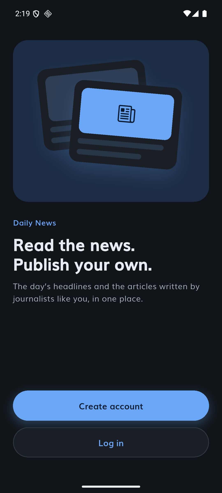 | 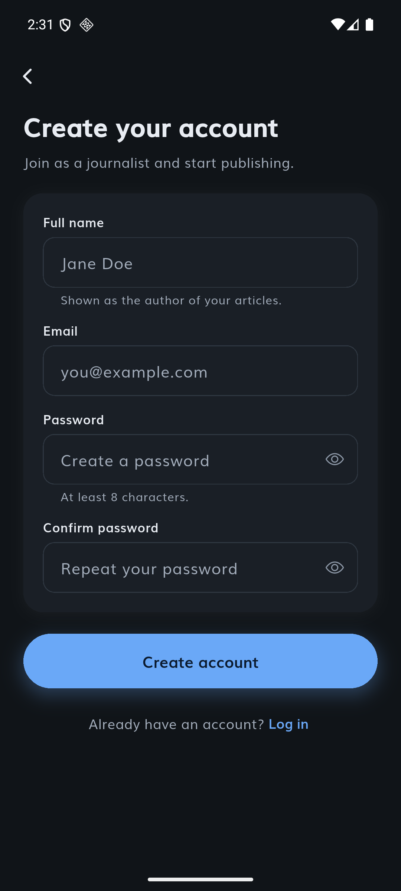 | 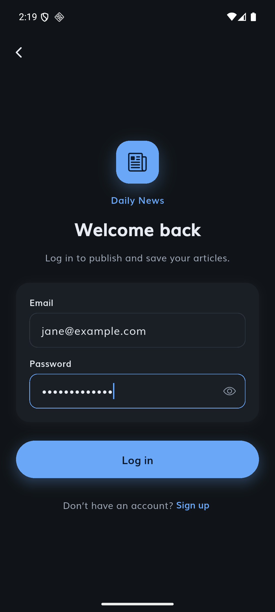 |

| Home · Daily News (NewsAPI) | Home · Journalists | Publish |
|:---:|:---:|:---:|
| 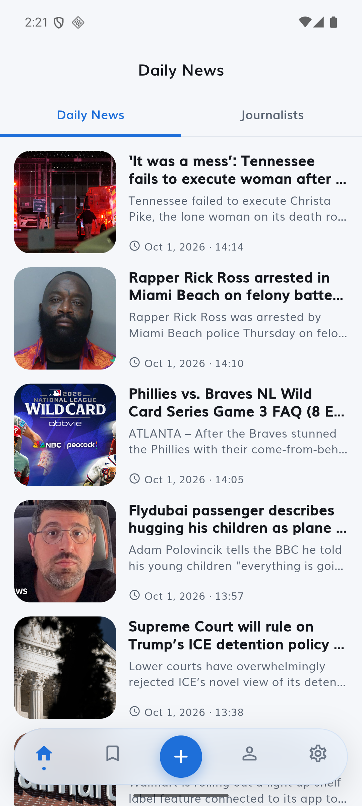 | 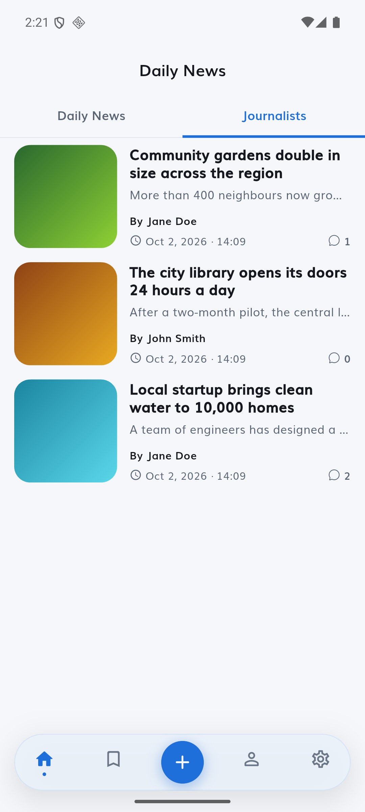 | 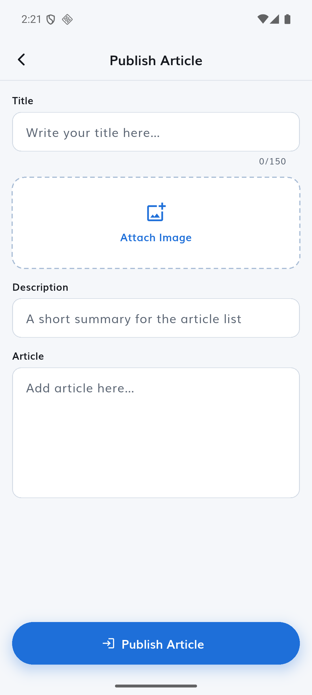 |

| Publish · validation | Publish · filled in | Article |
|:---:|:---:|:---:|
| 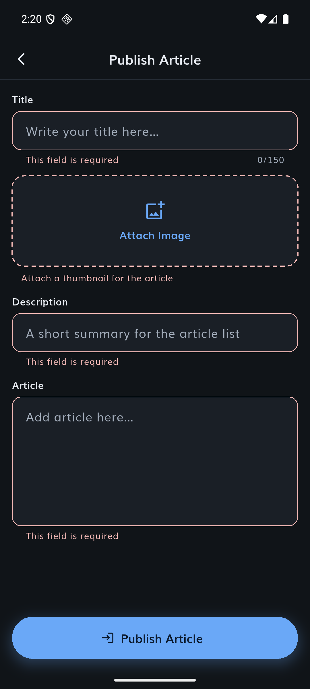 | 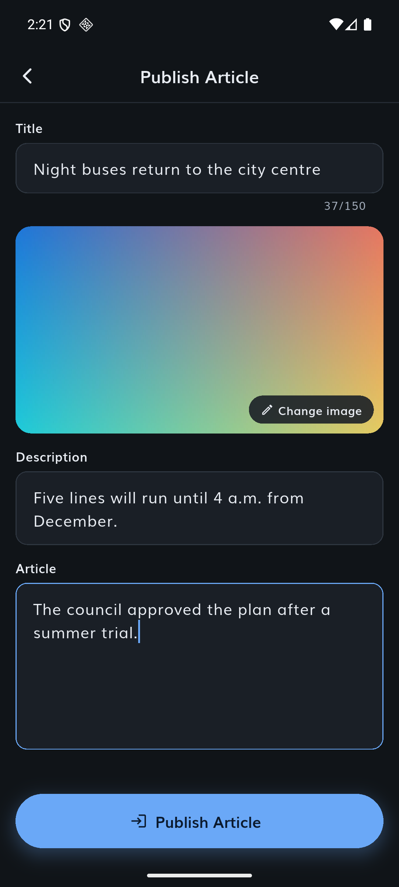 | 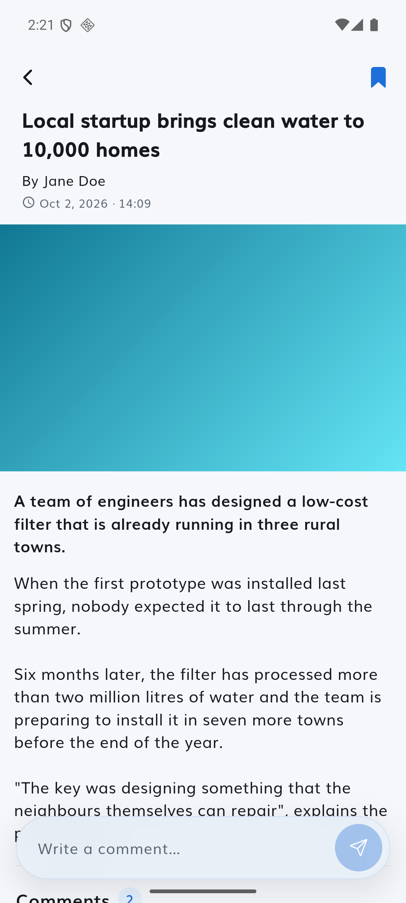 |

| Comments | Writing a comment | Saved, with a toast |
|:---:|:---:|:---:|
| 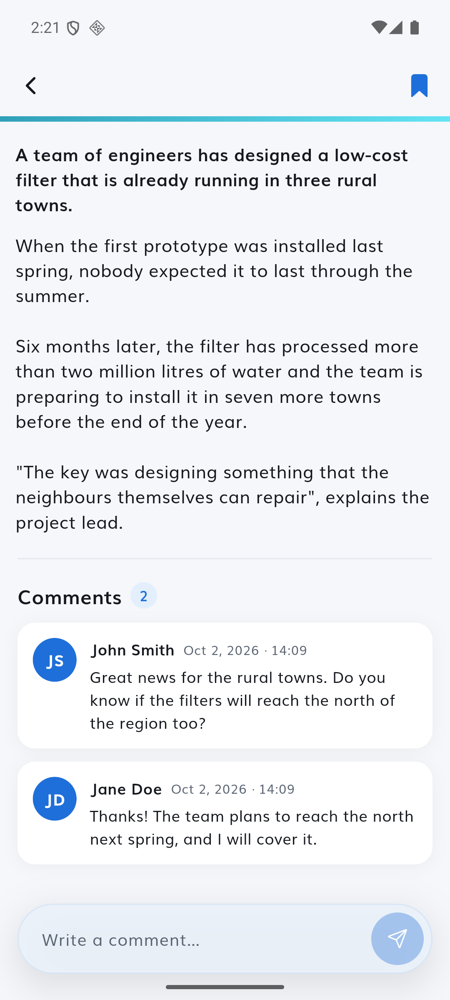 | 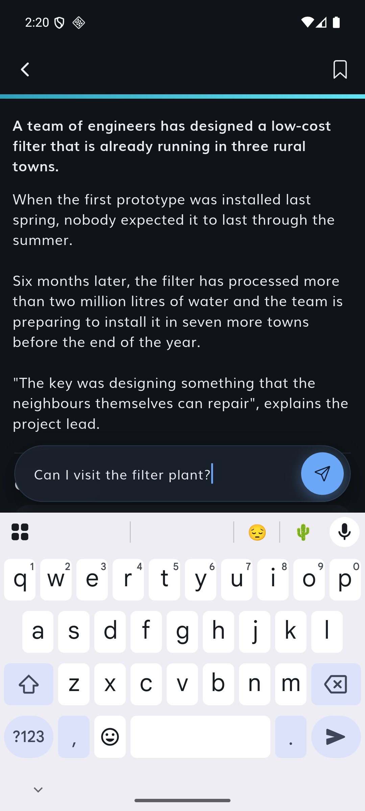 | 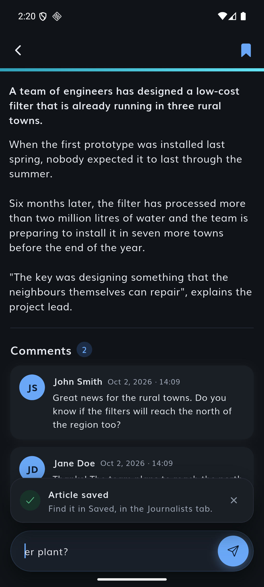 |

| Saved · Journalists | Saved · Daily News | Profile |
|:---:|:---:|:---:|
| 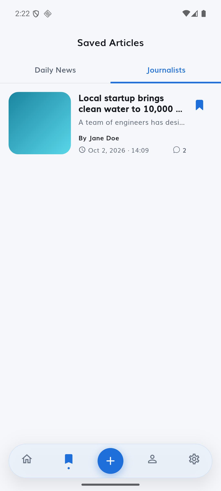 | 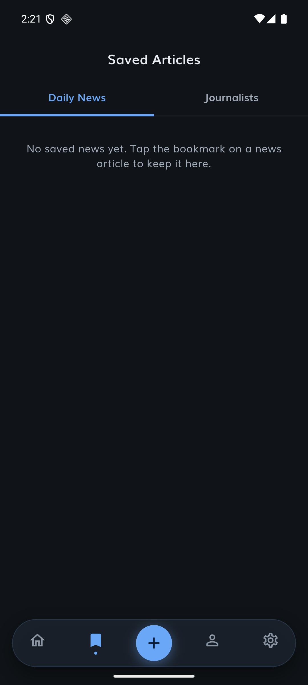 | 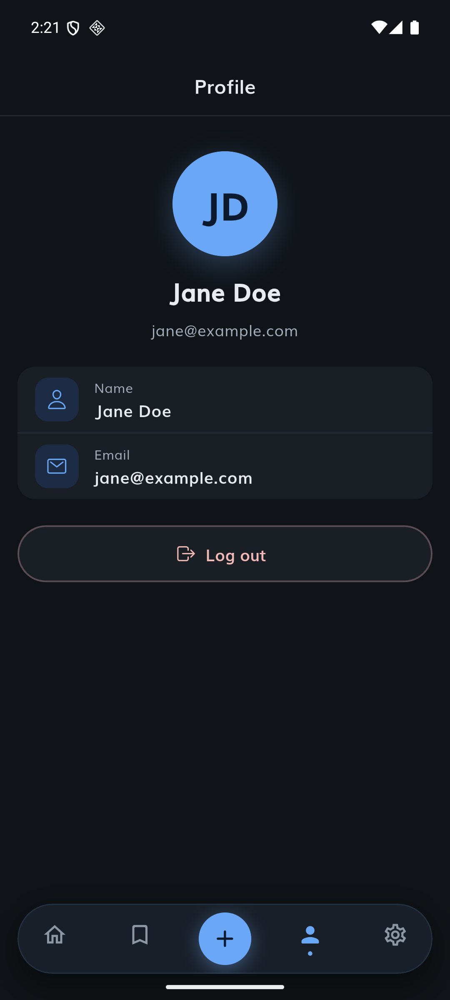 |

| Settings · light | Settings · dark |
|:---:|:---:|
| 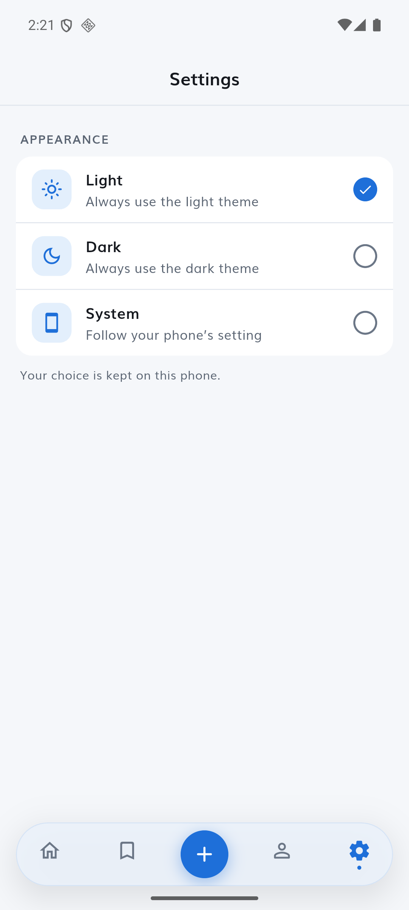 | 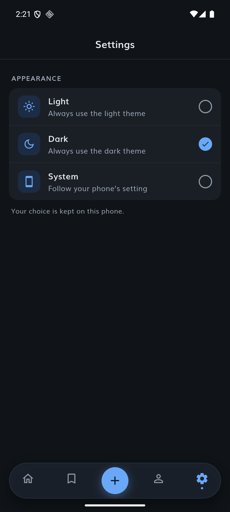 |

### Run it yourself
No Firebase account is needed. With Node.js, the Firebase CLI, Java 21, Flutter and an Android emulator (or, on a Mac,
the iOS Simulator):

1. `backend/`: `npm install`, `npm run emulators`, and in another terminal `npm run seed` (demo accounts and articles,
   listed in `backend/scripts/seed-data/users.json`).
2. `frontend/`: `flutter pub get`, `dart run build_runner build`, then `flutter run`. On Android, run
   `npm run android:connect` from `backend/` first.

The full steps are in [frontend/README.md](../frontend/README.md) and [backend/README.md](../backend/README.md).

## 6. Overdelivery

### 6.1 New features implemented

**Journalist accounts (Firebase Authentication).** A welcome screen, sign up and log in with email and password,
a persistent session and a profile with the journalist's initials. The author of an article is no longer typed in the
form: it is the account. The rules enforce it (`authorId == request.auth.uid` and `author == request.auth.token.name`),
so nobody can publish in someone else's name. *Purpose:* real authorship and security; the README only asked for
Firestore and Storage, so this deviation is documented in [DB_SCHEMA.md](../backend/docs/DB_SCHEMA.md).

**Comments.** Each journalist article shows how many comments it has; its page lists them (avatar with initials, name,
date, text) and journalists comment from a glass pill like the navigation bar. Stored in a subcollection with its own
rules and tests; counted with an aggregation query at read time, so articles stay immutable.

**Saved articles.** A bookmark in both article pages saves and removes. The Daily News articles (NewsAPI) stay on the
phone, as in the original app; the journalists' articles are saved in the account (`users/{uid}/savedArticles`, only
readable by its owner). The Saved section has the same two tabs as Home. It also fixed an original bug: saving the
same news twice created duplicates.

**Answers to the Figma notes on the publish screen.** Character limits (the same ones the rules enforce, with a counter
on the title), the gallery opening for photos only, tapping the image to change it, inline errors when publishing an
incomplete article, a "Publishing…" state while it uploads, and a confirmation when it is published.

**iOS.** The starter project only shipped the Android app. The same code now also runs on iOS, tested on the iPhone
simulator, with its own Firebase registration, icon, splash screen and photo library permission.

**Light, dark and system themes**, chosen in Settings and kept on the phone (a `settings` feature with its three layers).

**Own design.** A light palette ("not quite white" background) and a dark one, the Muli typeface of the original app,
a floating glass pill as the bottom navigation (inspired by Symmetry's own translucent footer, which I like), skeleton loaders that reuse the real layouts instead of spinners,
toasts for every message, and an app icon and splash screen that follow the phone's theme.

**Tests that check the code against the documentation** (see [section 7](#7-extra-sections)).

**A setup a reviewer can run in minutes**: emulators by default, a seed script that writes through the security rules
(so the sample data always follows the schema), demo accounts, and READMEs tested on a fresh clone.

*Demo:* every feature appears in the [videos](#videos) and the [screenshots](#screenshots).

### 6.2 Prototypes created

**UI prototype (Claude Design).** Before writing any screen, I designed the app as a clickable prototype that replaces
the Figma file: Home with both tabs, Saved, Publish, the article page with comments, Welcome, Log in, Sign up, Profile,
Settings, the toasts, the app icon and the splash screen, in light and dark. Each change was designed and approved
there first, then implemented. The whole design is exported here:
[symmetry-news-app-design.pdf](media/design/symmetry-news-app-design.pdf) (23 boards).

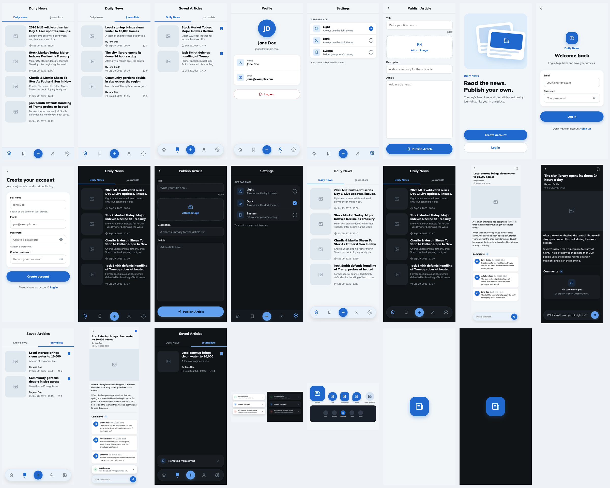

**Database schema.** [backend/docs/DB_SCHEMA.md](../backend/docs/DB_SCHEMA.md) documents every collection, field,
constraint, query and access rule, and why each NewsAPI field was kept, renamed or dropped. It is a contract: a backend
test fails if the rules or the app disagree with it.

**A promotional demo.** The 30 second film of [section 5](#videos), built from the app's real screens.

### 6.3 How can you improve this
- **Publish to the real project**: with Blaze, the same build would run against Firebase in production; App Check would
  then protect it.
- **Notifications**: tell a journalist when someone comments on their article.
- **Journalist profiles**: tap an author to see their articles.
- **Search and categories** for the journalists' articles, like the NewsAPI categories.
- **Offline-first**: Firestore's cache already keeps articles; drafts could be kept too, so a lost connection never
  loses an article.
- **Accessibility audit**: semantics are in place for the main flows (the toasts are announced); a full pass with
  TalkBack and large text would complete it.

## 7. Extra Sections

### 7.1 Tests

| Where | Tests | What they cover |
|---|---:|---|
| `frontend/test` | 285 | Entities, use cases, models, repositories, data sources (Firebase mocked), Cubits, screens and user journeys (sign up, log in, publish, comment, save, change theme) |
| `frontend/test/architecture` | 29 | The rules of APP_ARCHITECTURE.md and ARCHITECTURE_VIOLATIONS.md, checked on the source code |
| `backend/test/firestore.rules.test.mjs`, `storage.rules.test.mjs` | 93 | Every read and write the rules allow or reject, against the emulators |
| `backend/test/db_schema.test.mjs` | 18 | DB_SCHEMA.md against `firestore.rules`, `storage.rules` and the limits the app checks |

`frontend/test` mirrors `lib/` (one `{fileName}_test.dart` per file, as the documentation asks); `test/architecture`
is the one exception, because it checks `lib/` as a whole. Each architecture test is named after its rule, for example
*"1.1.2 the data layer does not import use_cases"*, and lists every file that breaks it. To make sure they are not
tests that always pass, I injected one violation of each kind into the code (a package in the domain, Dio in a
repository, a model in a screen, a use case in a widget, an import between features…): every one was caught.

```
cd frontend && flutter test                 # 314 tests
cd backend && npm run test:rules            # 111 tests (rules against the emulators, and the schema)
```

### 7.2 API keys in the repository
GitHub's secret scanning flags the Google API keys in `frontend/lib/firebase_options.dart`,
`frontend/android/app/google-services.json` and `frontend/ios/Runner/GoogleService-Info.plist`. They are Firebase API
keys, and as the [Firebase documentation](https://firebase.google.com/docs/projects/api-keys) explains, they are not
secrets: they identify the project and are meant to be inside the app, where anyone can read them. What protects the data
is the security rules: reading requires a signed-in account, articles and comments can only be written by their author's
account, saved articles are only visible to their owner, and nothing can be edited or deleted. Firebase App Check would
add a check that requests come from the app itself. The NewsAPI key in `frontend/lib/core/constants/constants.dart` is a
real secret, but it came committed in the starter project.

### 7.3 Commits
One commit per step of the README, then one per feature:
`(1.1)` schema · `(1.3)` rules · `(1.2)` seed of the collection · `(2.0)` toolchain and Firebase · `(2.1)` domain with
mock data · `(2.2)` presentation · `(2.3)` data layer · design · themes and pill · skeletons · accounts (backend,
frontend) · comments (backend, frontend) · saved articles (backend, toasts, frontend) · icon and splash · pure-Dart
domain · Daily News aligned with the docs · architecture tests · schema test · iOS · this report · code quality cleanup.
